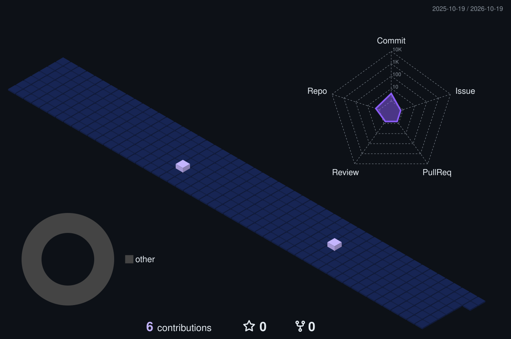

<div align="center">
  
</div>

<br/>


```text
Hey, I'm Ana Beatriz — a Systems Analysis & Development (ADS) student from Brazil 🇧🇷
building my path into Data & AI.

Before code, I spent years organizing, standardizing and structuring information in
corporate environments. Now I'm turning that instinct for order into data skills:
logical thinking, analysis, and AI that actually helps people decide better.
```


```text
📊  Data organization, structuring and analysis
🤖  Prompt engineering applied to data & business problems
🧩  Algorithms, logic and programming fundamentals
📈  AI-assisted analysis workflows (NotebookLM & friends)
```


```text
▸ Bradesco Bootcamp — GenAI, Data & Cyber           [ in progress ]
▸ Systems Analysis & Development degree             [ in progress ]
▸ Shipping hands-on mini-projects, not collecting certificates.
  Transparency over overselling.
```


<div align="center">
<table>
  <tr>
    <th>LinkedIn</th>
    <th>Instagram</th>
    <th>GitHub</th>
    <th>Discord</th>
  </tr>
  <tr>
    <td align="center"><a href="https://www.linkedin.com/in/abnasc"></a></td>
    <td align="center"><a href="https://www.instagram.com/abnasc"></a></td>
    <td align="center"><a href="https://github.com/anabeanasc"></a></td>
    <td align="center"><a href="https://discord.gg/WDFd6QZ2dX"></a></td>
  </tr>
</table>
</div>


<a href="https://github.com/anabeanasc/prompt-engineering-analise-dados-notebooklm-">
  
</a>


<div align="center">

&nbsp;

<br/><br/>

    

</div>


<div align="center">
  
  <br/><br/>
  
</div>


```text
"Many are the plans in a person's heart,
 but the Lord's purpose prevails."                          — Proverbs 19:21
```

<div align="center">
  <sub>⭐ If something here helps you, leave a star · 🤝 always open to collaborations and good ideas</sub>
</div>
